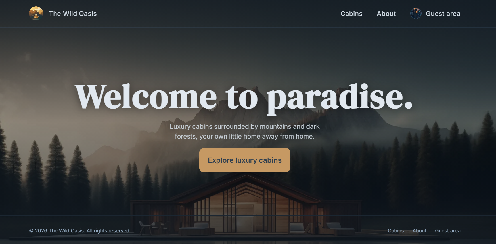
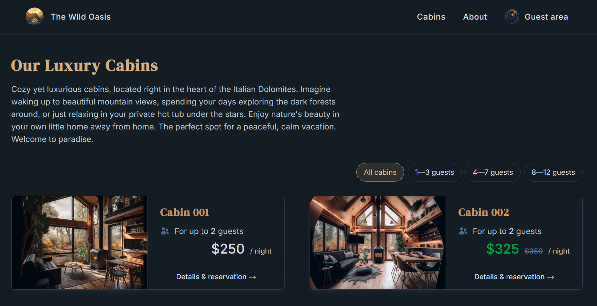
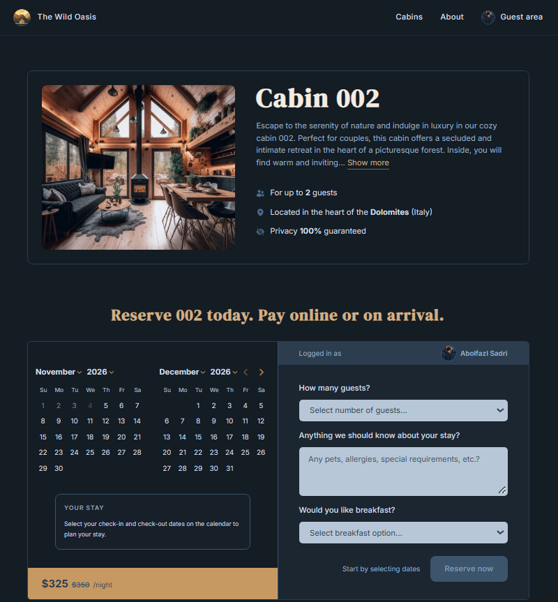
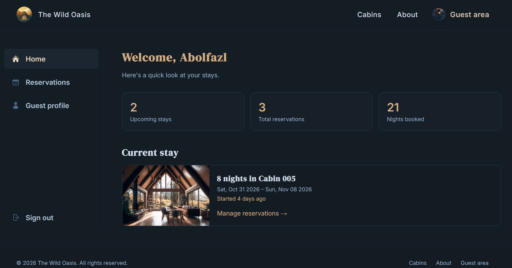

# The Wild Oasis Website

A luxury cabin booking website for a mountain retreat in the Italian Dolomites. Guests can browse cabins, pick dates on a live availability calendar, reserve a stay, manage their reservations, and pay online with Stripe.


**Live demo:** [https://the-wild-oasis-website-as.vercel.app](https://the-wild-oasis-website-as.vercel.app)









## Features

**For guests**

- Browse all cabins and filter them by capacity
- Cabin details with photos, a description, and a price that shows any discount
- Date range calendar that disables past days and days that are already booked
- Reservation form with guest count, special requests, and an optional breakfast add-on
- Sign in with Google
- Guest area with a reservations overview, a profile page, and a quick summary of upcoming stays
- Edit or delete upcoming reservations (deleting asks for confirmation and updates the list instantly)
- Pay for a reservation online with Stripe Checkout, with the payment status shown on every reservation
- Toast notifications with distinct colors for success, error, warning, and info
- Fully responsive layout with a mobile menu and a mobile-friendly reservation flow

**Under the hood**

- Prices, nights, guest limits, and date availability are validated on the server, never trusted from the browser
- Every reservation action checks that the reservation belongs to the signed-in guest
- Payments are confirmed by a signed Stripe webhook, and again when the guest returns to the site
- Reservation dates are stored as UTC calendar days, so they never shift between time zones
- Expected errors are returned as `{ error }` objects and shown as toasts, unexpected errors are thrown and handled by the error boundary

## Tech stack

| Area                 | Tools                                                                                 |
| -------------------- | ------------------------------------------------------------------------------------- |
| Framework            | [Next.js 16](https://nextjs.org) (App Router, Server Actions, Turbopack) and React 19 |
| Language             | TypeScript                                                                            |
| Styling              | Tailwind CSS 4, `clsx`, `tailwind-merge`, Heroicons                                   |
| Database and storage | [Supabase](https://supabase.com) (Postgres and public image storage)                  |
| Authentication       | [Auth.js](https://authjs.dev) (NextAuth v5) with Google OAuth                         |
| Payments             | [Stripe Checkout](https://stripe.com/payments/checkout) and webhooks                  |
| Calendar and dates   | DayPicker 10 (`@daypicker/react`) and `date-fns` 4                                    |
| UI feedback          | [Sonner](https://sonner.emilkowal.ski) toasts and a native `<dialog>` confirm dialog  |
| Countries            | `i18n-iso-countries` with flags from [flagcdn.com](https://flagcdn.com)               |
| Hosting              | [Vercel](https://vercel.com)                                                          |

## Getting started

### Prerequisites

- Node.js 20.9 or later
- A [Supabase](https://supabase.com) project
- A Google Cloud OAuth client ([credentials page](https://console.cloud.google.com/apis/credentials))
- A [Stripe](https://stripe.com) account in test mode and the [Stripe CLI](https://docs.stripe.com/stripe-cli)

### Installation

```bash
git clone https://github.com/abolfazllsadri/the-wild-oasis-website.git
cd the-wild-oasis-website
npm install
cp .env.example .env.local
```

On Windows PowerShell, use `copy .env.example .env.local` instead of `cp`.

### Environment variables

Fill in `.env.local`:

| Variable                   | Description                                                                                                          |
| -------------------------- | -------------------------------------------------------------------------------------------------------------------- |
| `NEXT_PUBLIC_SUPABASE_URL` | Your Supabase project URL                                                                                            |
| `SUPABASE_KEY`             | Supabase `service_role` key. **Server only: never expose it to the browser and never prefix it with `NEXT_PUBLIC_`** |
| `AUTH_SECRET`              | Random secret for Auth.js. Generate one with `npx auth secret`                                                       |
| `AUTH_GOOGLE_ID`           | Google OAuth client ID                                                                                               |
| `AUTH_GOOGLE_SECRET`       | Google OAuth client secret                                                                                           |
| `NEXT_PUBLIC_SITE_URL`     | Public URL of the site, e.g. `http://localhost:3000`                                                                 |
| `STRIPE_SECRET_KEY`        | Stripe secret key (`sk_test_...`)                                                                                    |
| `STRIPE_WEBHOOK_SECRET`    | Stripe webhook signing secret (`whsec_...`)                                                                          |

When you host the app behind a proxy outside Vercel, also set `AUTH_TRUST_HOST=true`.

### Google OAuth

In the Google Cloud Console, add these Authorized redirect URIs:

- `http://localhost:3000/api/auth/callback/google`
- `https://YOUR-DOMAIN/api/auth/callback/google` (production)

### Database

The app uses four Supabase tables, shared with the separate admin dashboard that manages cabins and bookings.

| Table      | Main columns                                                                                                                                                                                              |
| ---------- | --------------------------------------------------------------------------------------------------------------------------------------------------------------------------------------------------------- |
| `cabins`   | `id`, `name`, `maxCapacity`, `regularPrice`, `discount`, `image`, `description`                                                                                                                           |
| `guests`   | `id`, `fullName`, `email`, `nationality`, `countryFlag`, `nationalID`                                                                                                                                     |
| `bookings` | `id`, `created_at`, `startDate`, `endDate` (`timestamptz`), `numNights`, `numGuests`, `cabinPrice`, `extrasPrice`, `totalPrice`, `status`, `hasBreakfast`, `isPaid`, `observations`, `cabinId`, `guestId` |
| `settings` | `minBookingLength`, `maxBookingLength`, `maxGuestsPerBooking`, `breakfastPrice`                                                                                                                           |

Cabin photos live in a public Supabase Storage bucket named `cabin-images`. In `next.config.mjs`, set the Supabase hostname inside `images.remotePatterns` to your own project's host.

### Run the app

```bash
npm run dev
```

Open [http://localhost:3000](http://localhost:3000).

### Payments in development

Stripe sends payment events to a webhook, so forward them to your local server in a second terminal:

```bash
stripe login
stripe listen --forward-to localhost:3000/api/stripe/webhook
```

Copy the `whsec_...` value it prints into `STRIPE_WEBHOOK_SECRET` and restart the dev server. Then pay with the Stripe test card `4242 4242 4242 4242`, any future expiry date, and any CVC.

## Scripts

| Command             | Description                  |
| ------------------- | ---------------------------- |
| `npm run dev`       | Start the development server |
| `npm run build`     | Create a production build    |
| `npm run start`     | Run the production build     |
| `npm run prod`      | Build and start in one step  |
| `npm run lint`      | Lint with ESLint             |
| `npm run typecheck` | Type-check with TypeScript   |

## Project structure

```text
app/
  about/                 About page
  account/               Guest area: overview, reservations (list and edit), profile
  api/auth/              Auth.js route handlers
  api/stripe/webhook/    Stripe webhook endpoint
  cabins/                Cabin list, cabin details, thank-you page
  login/                 Sign-in page
components/              UI components (cards, forms, calendar, dialogs, navigation)
lib/
  actions.ts             Server Actions (reservations, profile, payments, auth)
  auth.ts                Auth.js configuration
  countries.ts           Country list and flag URLs
  data-service.ts        Supabase queries
  stripe.ts              Stripe client
  supabase.ts            Supabase config
  types.ts               Global types
  utils.ts               Helpers (class names, date handling)
proxy.ts                 Protects the /account routes
```

## How payments work

1. A guest reserves a stay. The reservation is saved with `isPaid = false`.
2. On the **Reservations** page, an unpaid upcoming reservation shows a **Pay now** button.
3. The button calls a Server Action that builds a Stripe Checkout session. The amounts (cabin price plus breakfast) come from the database, not from the browser.
4. After paying, Stripe calls `/api/stripe/webhook`. The endpoint verifies the signature and sets `isPaid = true`.
5. When the guest returns to the site, the session is verified once more so the status updates immediately.

Breakfast costs `guests × nights × breakfastPrice`, where `breakfastPrice` is read from the `settings` table.

## Deployment

The app is designed for [Vercel](https://vercel.com):

1. Import the repository and add all variables from the table above. Set `NEXT_PUBLIC_SITE_URL` to the final URL.
2. Add the production OAuth redirect URI to your Google client.
3. In the Stripe dashboard (Developers → Webhooks), add an endpoint `https://YOUR-DOMAIN/api/stripe/webhook` for the events `checkout.session.completed` and `checkout.session.async_payment_succeeded`, and use its signing secret as `STRIPE_WEBHOOK_SECRET`.
4. Keep Stripe in test mode until you activate your account and replace the keys with live ones.

## Ideas for the future

- Adopt Next.js Cache Components when Next.js 17 makes them the default
- Add automated tests for the reservation and payment logic
- Email confirmations for new reservations and payments
